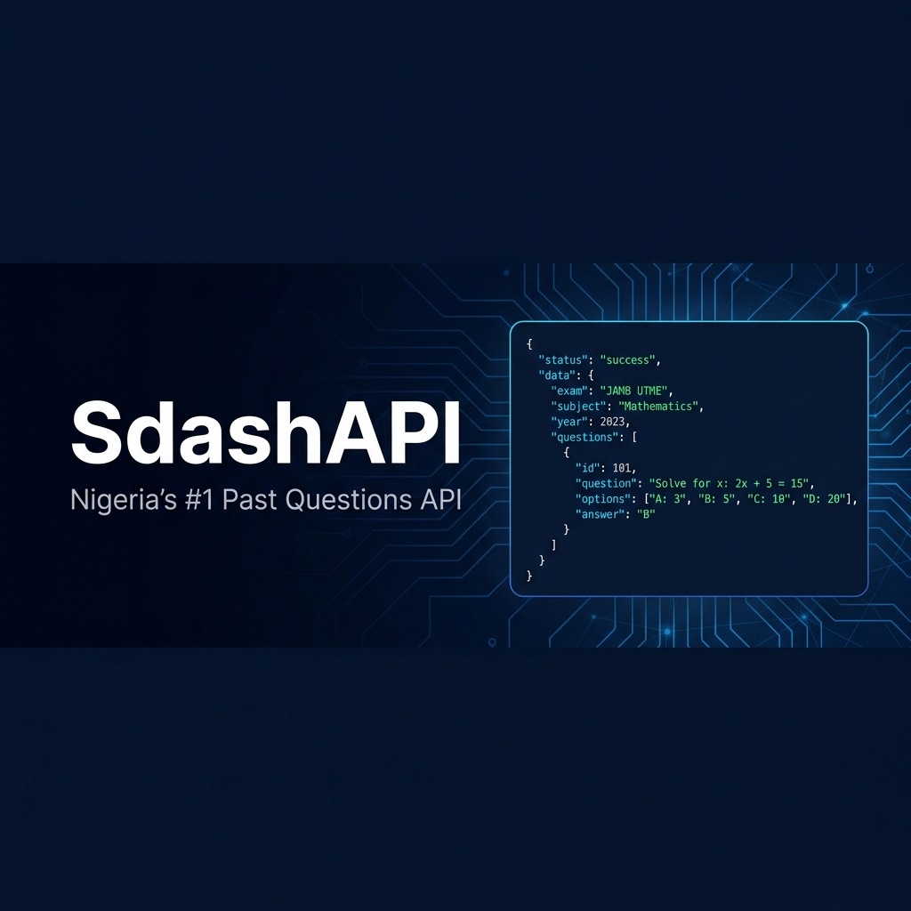

<div align="center">


# SdashAPI

### The #1 Nigerian Past Questions API

**Access 100,000+ past exam questions from JAMB/UTME, WAEC/WASSCE, NECO, Post-UTME, and University exams — via a single, blazing-fast REST API.**

[](https://sdashapi.com)
[](https://sdashapi.com/docs)
[](LICENSE)
[](https://sdashapi.com/docs)
[](https://sdashapi.com)
[](https://sdashapi.com)
[](https://sdashapi.com)
[](https://sdashapi.com)

[🚀 Get Started](https://sdashapi.com) · [📖 Documentation](https://sdashapi.com/docs) · [💬 Community](https://sdashapi.com/community) · [🐛 Report a Bug](https://sdashapi.com/community)



</div>

> **Keywords:** `JAMB past questions API` `WAEC past questions API` `NECO past questions API` `UTME questions API` `Post-UTME questions API` `Nigerian exam API` `GST past questions` `University past questions Nigeria` `Covenant University past questions` `UNILAG Post-UTME API` `OAU Post-UTME API` `FUTA Post-UTME API` `UNIBEN Post-UTME` `LAUTECH past questions` `Nigeria EdTech API` `past questions JSON API` `free past questions API Nigeria` `exam questions REST API`

---

## 📖 The Story Behind SdashAPI

Building EdTech in Nigeria is not for the faint-hearted. After years of building **[StudentsDash](https://studentsdash.com)** — a platform helping Nigerian students prepare for JAMB, WAEC, NECO, and Post-UTME — founder **Ogbu Chukwuemeka (Emmy)** had quietly assembled one of Nigeria's most comprehensive past questions databases. Thousands of verified questions. Decades of exams. Expert-written solutions.

Then came the pivotal question:

> *"These questions are just sitting here. What if every developer in Nigeria could access them instantly?"*

That thought became **SdashAPI** — Nigeria's most complete, developer-ready past questions API. Clean JSON. No scraping. No PDFs. Just one API call away.

📖 **[Read the full story →](STORY.md)** · 👤 **[About the founder →](https://studentsdash.com/emmy-biography/)**

---


**SdashAPI** is the most comprehensive and developer-friendly **Nigerian past questions API** available. Whether you're building an EdTech app, a student revision platform, a quiz engine, or a learning management system — SdashAPI gives you instant, structured access to a growing bank of past exam questions, answers, and full worked solutions.

- ✅ **JAMB / UTME** past questions (1990–present)
- ✅ **WAEC / WASSCE** past questions (1990–present)
- ✅ **NECO** past questions
- ✅ **Post-UTME** past questions (multiple universities)
- ✅ **University** exam questions (GST, GNS, course exams)
- ✅ **GCE** and **A-Level** questions
- ✅ Clean JSON responses — no scraping, no HTML parsing
- ✅ CORS-enabled — works from browser, mobile, or server
- ✅ Real-time answers + full worked solutions
- ✅ Covers: UNILAG, OAU, UNIBEN, UNIABUJA, FUTA, LAUTECH, UNIZIK, UNIPORT, ABU, EKSU, FUOYE, EBSU and more

---

## ⚡ Quick Start

### 1. Get your API key

Create a free account at **[sdashapi.com](https://sdashapi.com)** and copy your `AccessToken` from the dashboard.

### 2. Make your first request

```bash
curl "https://sdashapi.com/api/v1/q?subject=chemistry&type=utme" \
  -H "AccessToken: sdash_your_token_here"
```

### 3. Get back clean JSON

```json
{
  "status": 200,
  "data": {
    "id": 4821,
    "question": "Which of the following is the chemical formula for table salt?",
    "section": null,
    "option": {
      "a": "NaCl",
      "b": "KCl",
      "c": "CaCO3",
      "d": "NaOH"
    },
    "answer": "a",
    "solution": "NaCl is sodium chloride — one sodium atom bonded to one chlorine atom.",
    "image": null,
    "examtype": "UTME",
    "examyear": "2022"
  }
}
```

That's it. No complex setup. No SDK required.

---

## 📚 Endpoints

| Method | Endpoint | Description |
|--------|----------|-------------|
| `GET` | `/api/v1/q` | Fetch one or more past exam questions |
| `GET` | `/api/v1/subjects` | List all available subjects |
| `GET` | `/api/v1/exams` | List all exam types |
| `GET` | `/api/v1/years` | List all available years |
| `POST` | `/api/v1/report` | Report an incorrect or unclear question |

Full reference → **[sdashapi.com/docs](https://sdashapi.com/docs)**

---

## 🔍 Filter Questions Precisely

```bash
# Random chemistry question
GET /api/v1/q?subject=chemistry

# JAMB Biology 2019
GET /api/v1/q?subject=biology&type=utme&year=2019

# 10 random mixed questions
GET /api/v1/q?limit=10

# Specific question by ID
GET /api/v1/q?id=4821

# WAEC Mathematics questions
GET /api/v1/q?subject=mathematics&type=wassce
```

All requests require the `AccessToken` header:

```
AccessToken: sdash_your_token_here
```

---

## 💻 Code Examples

### JavaScript / Fetch

```javascript
const response = await fetch(
  'https://sdashapi.com/api/v1/q?subject=biology&type=utme&limit=5',
  { headers: { 'AccessToken': 'sdash_your_token_here' } }
);
const data = await response.json();
console.log(data);
```

### Python

```python
import requests

resp = requests.get(
    'https://sdashapi.com/api/v1/q',
    params={'subject': 'biology', 'type': 'utme', 'limit': 5},
    headers={'AccessToken': 'sdash_your_token_here'}
)
print(resp.json())
```

### PHP

```php
$ch = curl_init('https://sdashapi.com/api/v1/q?subject=biology&type=utme&limit=5');
curl_setopt($ch, CURLOPT_HTTPHEADER, ['AccessToken: sdash_your_token_here']);
curl_setopt($ch, CURLOPT_RETURNTRANSFER, true);
$data = json_decode(curl_exec($ch), true);
print_r($data);
```

### Node.js (axios)

```javascript
const axios = require('axios');

const { data } = await axios.get('https://sdashapi.com/api/v1/q', {
  params: { subject: 'chemistry', type: 'utme', year: 2022 },
  headers: { AccessToken: 'sdash_your_token_here' }
});
console.log(data);
```

### Dart / Flutter

```dart
final response = await http.get(
  Uri.parse('https://sdashapi.com/api/v1/q?subject=mathematics&type=utme&limit=10'),
  headers: {'AccessToken': 'sdash_your_token_here'},
);
final data = jsonDecode(response.body);
```

More examples → [`docs/examples/`](docs/examples/)

---

## 📦 Response Schema

Every question object follows this structure:

| Field | Type | Description |
|-------|------|-------------|
| `id` | `integer` | Unique question ID |
| `question` | `string` | The question text |
| `section` | `string\|null` | Shared passage/instruction (for comprehension sets) |
| `option` | `object` | Options `a`, `b`, `c`, `d` (and optionally `e`) |
| `answer` | `string` | Correct option key e.g. `"a"` |
| `solution` | `string\|null` | Full worked solution/explanation |
| `image` | `string\|null` | URL to associated image, if any |
| `examtype` | `string` | Exam name e.g. `"UTME"`, `"WASSCE"`, `"NECO"` |
| `examyear` | `string` | 4-digit year as a string e.g. `"2022"` |

> **Note:** When `limit=1` (default), `data` is an **object**. When `limit > 1`, `data` is an **array**.

---

## 🎯 Supported Subjects

| Subject | Slug |
|---------|------|
| Biology | `biology` |
| Chemistry | `chemistry` |
| Physics | `physics` |
| Mathematics | `mathematics` |
| English Language | `english` |
| Economics | `economics` |
| Government | `government` |
| Geography | `geography` |
| Commerce | `commerce` |
| Accounting | `accounting` |
| Literature in English | `englishlit` |
| CRK | `crk` |
| IRK | `irk` |
| Civic Education | `civiledu` |
| History | `history` |
| Current Affairs | `currentaffairs` |

Get the full live list via `GET /api/v1/subjects`.

---

## 🏆 Why SdashAPI?

| Feature | SdashAPI | Others |
|---------|----------|--------|
| JAMB/UTME past questions (1990–present) | ✅ Full | ⚠️ Partial |
| WAEC/WASSCE past questions | ✅ Full | ⚠️ Partial |
| NECO past questions | ✅ Full | ❌ Rarely |
| Post-UTME (multiple universities) | ✅ Full | ❌ No |
| University GST/GNS exam questions | ✅ Full | ❌ No |
| Worked solutions / explanations | ✅ Yes | ❌ Rarely |
| Clean, consistent JSON | ✅ Yes | ⚠️ Varies |
| CORS enabled (browser-safe) | ✅ Yes | ❌ Often not |
| Section/comprehension support | ✅ Yes | ❌ No |
| Option E support (5-option questions) | ✅ Yes | ❌ No |
| Active maintenance & updates | ✅ Yes | ❌ Abandoned |
| Community support forum | ✅ Yes | ❌ No |

---

## 🛡️ Authentication

Every request must include your `AccessToken` as an HTTP header:

```bash
-H "AccessToken: sdash_xxxxxxxxxxxxxxxxxxxx"
```

For quick browser testing only, you can use a query parameter:

```
?token=sdash_xxxxxxxxxxxxxxxxxxxx
```

Get your token by creating a free account at [sdashapi.com](https://sdashapi.com).

---

## ❌ Error Codes

| Status | Meaning |
|--------|---------|
| `200` | ✅ Success |
| `400` | Bad request — check your parameters |
| `401` | Missing or invalid `AccessToken` |
| `403` | Account suspended or plan expired |
| `404` | No questions matched your filters, or unknown endpoint |
| `405` | Wrong HTTP method |
| `429` | Rate limit exceeded — upgrade your plan |

---

## 🗺️ Roadmap

- [x] JAMB / UTME questions (1990–present)
- [x] WAEC / WASSCE questions (1990–present)
- [x] NECO past questions
- [x] Post-UTME questions (UNILAG, OAU, UNIBEN, UNIABUJA, FUTA, ABU, LAUTECH, UNIZIK + more)
- [x] University course & GST/GNS exam questions
- [x] GCE / O-Level questions
- [x] Full worked solutions & explanations
- [x] Image support for diagram questions
- [x] Community forum
- [ ] Webhook notifications for new questions
- [ ] Official SDKs for JavaScript, Python, PHP, Dart
- [ ] GraphQL endpoint
- [ ] Question difficulty ratings
- [ ] Topic/chapter-level filtering
- [ ] Mock exam generator endpoint

---

## 👤 About the Founder

**SdashAPI** was built by **Ogbu Chukwuemeka (Emmy)** — a Nigerian software developer and EdTech entrepreneur who has spent years building technology that bridges the gap between Nigerian students and academic success.

Emmy is the founder of **[StudentsDash](https://studentsdash.com)**, a student platform that powers the question bank behind SdashAPI. His mission: make quality exam preparation accessible to every Nigerian student, and give developers the tools to build the next generation of EdTech apps.

📖 [Read Emmy's full biography →](https://studentsdash.com/emmy-biography/)  
📖 [Read the full SdashAPI story →](STORY.md)

---


We welcome contributions to improve the community, docs, and SDKs!

See [CONTRIBUTING.md](CONTRIBUTING.md) for guidelines.

---

## 📜 License

This project is licensed under the MIT License — see [LICENSE](LICENSE) for details.

The **question content** (past exam questions) is the intellectual property of their respective examination bodies (JAMB, WAEC, NECO) and is provided here for educational purposes.

---

## 📞 Support

- 📖 **Documentation:** [sdashapi.com/docs](https://sdashapi.com/docs)
- 💬 **Community Forum:** [sdashapi.com/community](https://sdashapi.com/community)
- 📧 **Email:** support@sdashapi.com

---

---

## 🏷️ Topics

`nigeria` `past-questions` `jamb` `waec` `neco` `utme` `wassce` `post-utme` `university` `gst` `gns` `api` `rest-api` `json` `edtech` `education` `exam` `quiz` `nigerian-students` `javascript` `python` `php` `flutter` `dart` `unilag` `oau` `uniben` `futa` `abu` `lautech` `uniabuja` `unizik` `uniport` `eksu` `fuoye`

---

<div align="center">

**Built with ❤️ for Nigerian students and developers**

⭐ **Star this repo** if SdashAPI powers your project!

[](https://sdashapi.com)
[](https://sdashapi.com/docs)
[](https://sdashapi.com/community)

</div>
